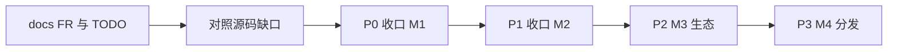

# 配置与开发计划

## 盘点结论

- **仓库根**：`/Users/deshun/Data/Project/ai-workflow-monitor`
- **操作**：Cursor 初始化（当前无 `.agents/`、`AGENTS.md`、`.cursor/rules`）
- **目标产品**：Cursor（用户确认）；不写 Codex / Claude Code / 其他 IDE 原生目录
- **Git**：不是 Git 仓库（`inventory.py` 返回 `not_repository`，`scan_complete: false`）。不影响写配置，但不能声称暂存区未动。本轮**不** `git init`、不改 CI、不改业务代码
- **实现水位**：引擎主干（schema / store / FSM / 扫描 / 心跳 / SSE 控制 API / stdio MCP / claude-code 提取器）已落地。README 写「M0+M1+M2 已实现」偏高，见下方路线

---

## A. Cursor AI 工程化配置（批准后写入）

公共正文只写项目事实与阅读路由，不绑定 Cursor、不写本次核验状态。原生触发留在 `.cursor/rules`。正文维护源在 `.agents/`，`.mdc` 只做短触发 + 指向共享文件，避免两套规则。

### 将创建的文件

**入口与手册**

- [`AGENTS.md`](AGENTS.md)：工作边界、按任务阅读路由、命令（`pnpm dev` / `sh scripts/l1-verify.sh`）、禁止自动 commit
- [`.agents/AI-CODING.md`](.agents/AI-CODING.md)：文件导航、日常任务（定位 / 实施 / 审查 / 知识维护）、验收方法

**知识（项目证据，不编造）**

- [`.agents/knowledge/architecture.md`](.agents/knowledge/architecture.md)：pnpm workspace、`schema ← store ← core ← adapters/apps`、进程模型（主进程 + 渲染 + `awm-mcp`）、数据流（JSONL → 探测 → FSM → SSE/播报/托盘）
- [`.agents/knowledge/constraints.md`](.agents/knowledge/constraints.md)：C-01 本地优先、C-08 依赖最小化、ADR-11 渲染层零依赖、ADR-12 手写 MCP、ADR-13 `runtime.json`、ADR-15 心跳进程佐证；核心包禁止具体工具名
- [`.agents/knowledge/verification.md`](.agents/knowledge/verification.md)：L1=`sh scripts/l1-verify.sh`（typecheck + test + lint → `.verify/l1.log`）；L3 默认禁止；跨包必须 `@awm/*`

**规则（每条一主题）**

- [`.agents/rules/package-boundaries.md`](.agents/rules/package-boundaries.md)：依赖方向与 `no-restricted-imports`
- [`.agents/rules/adapter-contract.md`](.agents/rules/adapter-contract.md)：manifest YAML + 可选提取器；core 零工具名；空 `eventMapping` 合法但不产生事件
- [`.agents/rules/renderer-native.md`](.agents/rules/renderer-native.md)：渲染层无 React/Vite/import-export（ADR-11）
- [`.agents/rules/local-first.md`](.agents/rules/local-first.md)：扫描只读声明路径、控制 API 仅 127.0.0.1、不读 `.env*` / 凭证

**Skills + 模板（有流程才写，不凑空文件）**

- [`.agents/skills/deliver-feature/SKILL.md`](.agents/skills/deliver-feature/SKILL.md)：对照 FR/TODO、改最小面、跑相关测试
- [`.agents/skills/review-readonly/SKILL.md`](.agents/skills/review-readonly/SKILL.md)：只读审查交接
- [`.agents/skills/sync-knowledge/SKILL.md`](.agents/skills/sync-knowledge/SKILL.md)：实现变化后更新 `.agents/knowledge`
- [`.agents/skills/add-adapter/SKILL.md`](.agents/skills/add-adapter/SKILL.md)：按 claude-code 模式加 manifest + 提取器 + fixture，不改 core
- [`.agents/templates/task-brief.md`](.agents/templates/task-brief.md)、[`.agents/templates/review-handoff.md`](.agents/templates/review-handoff.md)

**Cursor 原生触发（短，指向 `.agents/`）**

- [`.cursor/rules/project.mdc`](.cursor/rules/project.mdc)：`alwaysApply: true`，边界 + 阅读 `AGENTS.md`
- [`.cursor/rules/core-no-tool-names.mdc`](.cursor/rules/core-no-tool-names.mdc)：`globs: packages/core/**/*.ts`
- [`.cursor/rules/adapters.mdc`](.cursor/rules/adapters.mdc)：`globs: packages/adapters/**/*`
- [`.cursor/rules/renderer.mdc`](.cursor/rules/renderer.mdc)：`globs: apps/desktop/src/renderer/**`

**明确不做**

- 不建 `.cursor/agents/`（未要求独立审查角色）
- 不改 `package.json`、ESLint、CI、MCP、业务源码
- 不把验证结果写进公共手册

写入后静态核对：清单一致、相对引用闭合、无空占位、公共正文无客户端身份。不为配置验证跑 `pnpm test`。

---

## B. 产品开发计划（只列，本轮不编码）

对照 [`docs/design/detailed-design.md`](docs/design/detailed-design.md) 第 10 章 TODO-01~34、[`docs/product/product-design.md`](docs/product/product-design.md) FR-01~29，以及源码。

**已完成（可当基线）**：TODO-02/04/06/07/08/10/11/15。claude-code 全链路可用。

**部分完成**：TODO-01（无 CI）、03（无 JSON 快照、`mcp_servers` 无 DAO）、05（无热加载）、09（托盘 1×1 占位图）、12（Cursor/Codex 仅探测）、13（乱序补正仍是 FIFO）、14（无一键转回 running）、16（`PriorityQueue` 未接入 `VoiceService`）、17（无 Piper）、18~21（UI 简版）、22（SSE 而非设计里的 WS）、23（无 streamable-http）、25（死 JSON）、27（无通知中心）、28（native TTS 仅 darwin）。

**未做**：TODO-24 MCP Client、26 适配器扩到 6、29 SDK、30 规则矩阵/导出、31 云 TTS、32~34 签名/压测/文档站。

### P0 — 收口 M1（下一轮产品工作的第一批）

目标：三工具闭环真正可用，而不只是探测到已安装。

1. **Cursor / Codex 事件语义（TODO-12 / FR-06）**  
   - Codex：`~/.codex/sessions/**/*.jsonl` 已声明，需拿一条真实会话补 `eventMapping` + 提取器 + fixture（仿 [`packages/adapters/src/claude-code/extract.ts`](packages/adapters/src/claude-code/extract.ts)）  
   - Cursor：`state.vscdb` 无公开契约，**禁止编造映射**；有实测样本再写，否则保持空映射并在 UI 标明「仅探测、无会话事件」
2. **播报打断接线（TODO-16 / FR-13）**：把 [`packages/core/src/voice/queue.ts`](packages/core/src/voice/queue.ts) 接到 [`apps/desktop/src/main/voice-service.ts`](apps/desktop/src/main/voice-service.ts)
3. **乱序补正（TODO-13）**：兑现 [`packages/core/src/bus/event-bus.ts`](packages/core/src/bus/event-bus.ts) 里的 `TODO(M1)`
4. **看板与详情（TODO-20/21 / FR-08/22/23）**：四列（待介入 / 执行中 / 失败 / 完成）；详情提供重试 / 转回 running / 归档（可先按钮，拖拽可后置，避免为拖拽引入 React，见 ADR-11）
5. **查询导出最小集（FR-10）**：现有 `GET /api/v1/events` 加上导出 JSON
6. **工程**：可选 `git init` + 最小 CI 跑 `scripts/l1-verify.sh`（需另授权；AI 配置技能本身不改 CI）

验收：`sh scripts/l1-verify.sh`；Codex 至少 1 套契约 fixture；看板四列手工点一次（L3 仅在要求时做）。

### P1 — 收口 M2

1. **FR-16 配置生成器**：Claude Code / Cursor / Codex / VSCode 片段 + 一键复制（替换设置页死 JSON）
2. **FR-24 通知中心**：播报/通知历史，已读与级别筛选
3. **FR-18/19 MCP Client**：给空表 `mcp_servers` 补 DAO + 连接/枚举；无实测外部 server 前不做事件注入的假实现
4. **手动忽略已有、手动添加路径（FR-04 后半）**
5. **Windows SAPI（TODO-28）**：非本机 macOS 主路径，可并行但不阻塞 P0
6. **补 ADR**：SSE 替代 WebSocket 应写入 `docs/adr/`，避免文档与代码长期分叉
7. **不扩到 6 个适配器**，除非有真实会话样本（Gemini CLI / Windsurf 等同 TODO-12 问题）

### P2 — M3 生态

规则矩阵 UI、用户模板、`adapter-validator` CLI、通知操作按钮、Piper/云 TTS（显式开启）。第三方适配器导入（FR-29）依赖 SDK。

### P3 — M4 分发

签名公证、10×100 压测、隐私白皮书、文档站。Git/CI/签名账号未就绪则只出内测包。

### 明确后置或放弃（除非另授权）

- 扫描改子进程（RK-07）：现主进程 `setInterval`，性能未测前不拆
- 渲染层迁 React：ADR-11 已否决，仅当拖拽/虚拟滚动成为硬需求再评
- GitHub Copilot 适配器：无独立进程与稳定会话格式，继续刻意不写
- 任务代操作、多机协同、云同步：产品边界 1.1 禁止
- 商标/域名（TODO-N01/N02）：业务事项，不进代码

### 建议执行顺序（后续会话）

`AI 配置（本轮）` → `P0 M1 收口` → `P1 配置生成器 + 通知中心` → `有样本再补适配器` → `M3/M4`

P0 里 Cursor 事件在无样本时应跳过提取器，只做 UI 能力说明，避免假映射污染状态机。
