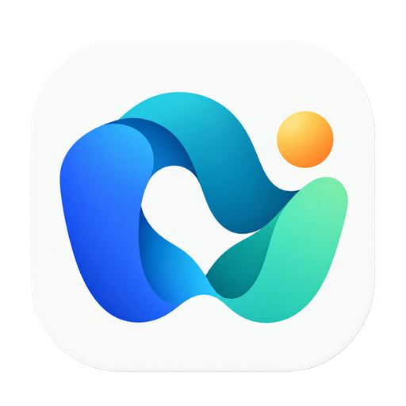

<p align="center">
  
</p>
<h1 align="center">AgentCue</h1>
<p align="center">看见 AI 在做什么，需要你时及时提醒。</p>
<p align="center">
  <a href="https://github.com/ideshun/AgentCue/actions/workflows/l1.yml"></a>
  <a href="https://github.com/ideshun/AgentCue/releases"></a>
  <a href="LICENSE"></a>
</p>

AgentCue 是一款本地优先的 AI 编码任务监控桌面应用。将多个工具的任务集中到看板和动画办公室，在任务开始、需要确认、任务完成时按你的规则提醒，减少反复切换窗口。

## 下载与安装

从 [Releases](https://github.com/ideshun/AgentCue/releases) 下载对应安装包。当前正式版为 **v1.0.0**，基于 Rust + Tauri 2。

| 系统 | 安装包 |
| --- | --- |
| macOS · Apple 芯片 | `AgentCue_1.0.0_aarch64.dmg` |
| macOS · Intel | `AgentCue_1.0.0_x64.dmg` |
| Windows · x64 | `AgentCue_1.0.0_x64-setup.exe` |
| Linux · x64 | `AgentCue_1.0.0_amd64.deb` 或 `AgentCue_1.0.0_amd64.AppImage` |

macOS 将应用拖入「应用程序」后启动；Windows 运行安装程序；Linux 给 AppImage 添加执行权限后运行。安装版自带运行环境，无需安装 Node.js、pnpm 或拉取源码。

本正式版尚无正式代码签名和 macOS 公证，macOS 可能提示开发者未验证。四个平台均经过 CI 构建与包内自检；完整系统交互和音频设备的人工验收以 macOS 为主。下载附件可使用同一 Release 中的 `SHA256SUMS.txt` 校验。

## 能做什么

- **任务看板**：按待介入、执行中、需要检查、已结束分列，搜索、筛选并查看时间线。
- **动画办公室**：工具化身员工，工位展示真实任务状态；重要消息主动出现，其他信息悬浮查看。
- **语音与通知**：系统音色、本地 Kokoro / ZipVoice，以及需要显式启用的云语音；支持试听、音量、免打扰和全局静音。
- **独立播报接入**：按工具提供 Hooks 和 MCP 配置，复制、粘贴并验证，无需额外启动桥接服务。
- **本地数据**：任务记录和设置保存在本机；采集可关闭，工具可忽略。云语音关闭时不会上传播报文本。

## 支持的工具与边界

| 工具 | 任务事件来源 | 需要确认提醒 |
| --- | --- | --- |
| CodeX 桌面客户端 / CLI | 本机公开 rollout 文件，按任务轮次采集 | 审批未落盘，不能可靠推断 |
| Claude Code | 官方 Hooks；兼容 JSONL 采集 | `permission_prompt` 通知 |
| Cursor 自带 Agent | 官方 Hooks | `AskQuestion` 调用 |
| Cursor 中的 Cline | 扩展安装识别 + 官方 Hooks；历史索引另列 | 以实际提供的 Hook 事件为准 |
| Cursor 中的 CodeBuddy | 扩展安装识别 + 官方 Hooks | 以实际提供的 Hook 事件为准 |

**识别已安装、MCP 连通与任务播报接入是不同能力。** 仅识别安装或配置 MCP 不会凭空产生任务事件；请按工具完成 Hooks 配置。历史快照不计作正在执行的任务，缺少状态时显示未知。

## 首次使用

1. 打开「工具与扩展」，核对已识别工具；在设置中开启需要的本地来源读取。
2. 打开「播报接入」，展开对应工具的 Hooks 或 MCP，按步骤合并配置，保留原有条目。
3. 重新加载对应工具并发起新任务，核对「最近事件」和任务看板。
4. 在设置中选择后端与音色，**保存后试听**。本地模型需要你主动下载，不会随首次启动自动下载。
5. 如需任务开始、完成也发声，将播报范围设为包含里程碑；默认仅待确认发声，其余里程碑保留通知。

全局静音优先于免打扰例外。历史补采和重复事件不会重复自动播报。Windows 的自动生成 Hooks 命令目前未就绪，界面会明确提示；MCP 与文件采集能力单独判断。

[完整接入说明](docs/integrations/task-hooks.md) · [隐私说明](docs/privacy.md)

## 安装包体积与语音模型

v1.0.0 使用 Rust + Tauri 2 和系统 WebView，不再把 Chromium 与 Node.js 打进安装包；各平台的实际下载大小见 Release 附件。安装包仍包含本地 TTS 推理运行库，Kokoro / ZipVoice 模型由用户在应用中主动下载，不随包分发。v0.2.0 的 Electron 安装包继续保留在旧版 Releases 中。

全部插画原稿、历史版本和设计说明仍保留在仓库中，只是不进入应用包。编译源码、中间文件和未使用的插画版本也不会打进安装包。

## 更新与已有数据

完全退出旧版，再用新版替换应用。当前暂不提供自动更新。

AgentCue 原名 AI Workflow Monitor。为兼容已有设置、历史记录、模型与握手文件，数据目录名继续保留：

| 系统 | 默认数据目录 |
| --- | --- |
| macOS | `~/Library/Application Support/AI Workflow Monitor/` |
| Windows | `%APPDATA%/AI Workflow Monitor/` |
| Linux | `$XDG_CONFIG_HOME/AI Workflow Monitor/`，未设置时使用 `~/.config/AI Workflow Monitor/` |

从开发版迁到安装版、从旧名称更名或移动安装位置后，到「播报接入」更新原 Hooks / MCP 条目的启动路径一次；同一安装路径下更新通常不需要重配。MCP Server 键 `ai-workflow-monitor`、CLI `awm-mcp` 和包 scope `@awm/*` 保持兼容，避免重复添加。

## 从源码开发

需要 Node.js 22 和项目指定的 pnpm 10.6.0。

```sh
git clone https://github.com/ideshun/AgentCue.git
cd AgentCue
corepack enable
pnpm install --frozen-lockfile
sh scripts/l1-verify.sh
pnpm dev
```

`better-sqlite3` 需匹配 Electron ABI。项目测试脚本会探测可用运行时，不会为跑测试重编译共享模块或读取生产数据库。`pnpm dev` 会先对齐桌面原生依赖；跨平台打包应在对应系统与架构运行。

**1.0 正式版**使用 Rust + Tauri 2，复用 TypeScript / CSS 页面及办公室。安装 rustup 后，运行 `pnpm rust:verify` 验证核心，运行 `pnpm tauri:bundle` 构建当前平台的安装包。构建、隔离运行及 Hooks / MCP 升级说明见 [原生版交付手册](docs/native-preview.md)。迁移决策见 [ADR-21](docs/adr/ADR-21-rust-tauri-migration.md)。

- [开发与架构说明](docs/development.md)
- [版本发布与安装包验证](docs/releasing.md)
- [产品与设计文档](docs/README.md)
- [更新日志](CHANGELOG.md)

## 反馈与许可

在 [Issues](https://github.com/ideshun/AgentCue/issues) 提交问题时，提供系统、CPU 架构、应用版本、复现步骤和脱敏错误。请勿提交 `settings.json`、`runtime.json`、API Key、数据库或完整会话内容。

原创代码采用 [MIT](LICENSE)；第三方依赖、字体和工具图标遵循各自许可，见 [第三方说明](THIRD_PARTY_NOTICES.md)。
