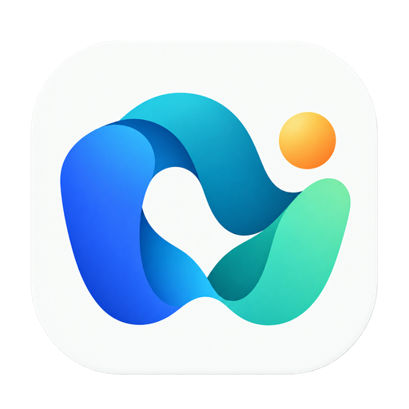

# AgentCue 图标 · 汇流

2026-10-26 · 设计稿 v1 · 使用内置 image_gen 完成本次 image2 请求。

## 设计定位

AgentCue 的核心价值是把多个 AI 编码工具的任务状态汇集到一个地方，并在需要人工确认等关键节点提醒用户。图标以「多路任务，汇成一眼可读的状态」为主题，采用简洁、亲和的效率工具语言。

## 设计思路

- **W 形汇流**：蓝、青、绿三个宽曲面连接成一个整体，W 对应 Workflow。多路进入、统一观察，与跨工具任务监控的定位对应。
- **开放留白**：中央留出清楚的观察窗口，让主体轮廓在小尺寸下仍能分开，避免把界面内容塞进图标。
- **暖色信号点**：琥珀色圆点表达需要人关注的关键节点。它是固定品牌元素；实际任务状态仍由应用界面表达。
- **稳定与亲和**：蓝绿主体体现持续工作与有序流转，圆润端点降低工具的生硬感；浅色圆角底让标志在深浅桌面背景中都有稳定边界。
- **尺寸优先**：用大轮廓、宽色面和明确留白建立识别，控制渐变层次，保持无字、无细线的主体。

## 风格参考

以下是对用户指定产品图标的设计解读，用于提炼视觉原则；本图形由 image2 生成，参考产品的图标未作为输出部件使用。

| 参考产品 | 提炼的原则 | 本方案中的体现 |
| --- | --- | --- |
| [Google](https://about.google/brand-resource-center/) | 色彩分区清楚、主形易辨 | 少量主色，大色面组成单一主体 |
| [Microsoft Edge](https://www.microsoft.com/en-us/edge) | 曲线流动、渐变有方向 | 蓝至青绿的连续曲面 |
| [QQ](https://im.qq.com/) | 远看也能识别的外轮廓 | 圆润、紧凑、有记忆点的 W 形 |
| [微信](https://weixin.qq.com/) | 亲和、饱满、视觉焦点集中 | 柔和端点与清楚的主次 |
| [飞书](https://www.feishu.cn/) | 精简的拼接与折叠几何 | 曲面交汇处形成有层次的连接 |
| [DeepSeek](https://www.deepseek.com/) | 单一符号承担品牌识别 | 图标不依赖文字说明 |
| [字节跳动](https://www.bytedance.com/zh/) | 简单单元构成视觉节奏 | 三段流动曲面与一个信号点 |

## 色彩与构图

生成提示词以钴蓝 `#3867EF`、深青 `#087F8C`、青绿 `#39CDA3`、琥珀 `#FFBC55` 和浅瓷白 `#F8FAF7` 为色彩方向。实际 PNG 包含连续渐变，以上是设计目标色，不是对每个像素的色值声明。

圆角底板约占画布的 86%，四周保留透明安全区。所有导出共用同一原图、中心和缩放关系。

## 交付文件

| 文件 | 规格 | 使用位置 |
| --- | --- | --- |
| [master.png](master.png) | 原生 1254 × 1254，RGBA | 保留 image2 最终原始输出 |
| [png/icon-1024.png](png/icon-1024.png) | 1024 × 1024 | 高清应用图标、后续分发源 |
| [app-icon.icns](app-icon.icns) | macOS 图标容器，含 Retina 尺寸 | macOS 应用与 Dock |
| [app-icon.iconset/](app-icon.iconset/) | 标准尺寸 PNG 集 | macOS 图标重建 |
| [app-icon.ico](app-icon.ico) | 16、20、24、32、48、64、128、256px | Windows 应用图标 |
| [png/icon-512.png](png/icon-512.png) | 512 × 512 | Linux 桌面图标 |
| [png/](png/) | 16、20、24、32、48、64、128、256、512、1024px | 其他界面和多尺寸使用 |
| [previews/sizes-light-dark.png](previews/sizes-light-dark.png) | 深浅背景，按标注像素原尺寸排布 | 识别度检查 |
| [exports.json](exports.json) | 尺寸、生成来源与文件校验信息 | 资源追踪 |
| [prompts.md](prompts.md) | 初稿及最终稿完整提示词 | 复现与后续修改 |

生成源为 PNG。导出阶段进行尺寸转换和平台容器封装，保留透明通道。资源作为独立设计稿交付。

## 检查范围

已检查 16、24、32、48、64、128、256px 在深浅背景上的静态显示；输出文件的尺寸和平台容器另通过本地工具解析。此处的预览与文件检查不等于各操作系统安装后的实际显示验收。
